  
  
  
  
  

  
  
  

## About me

Systems Engineer from Santa Cruz de la Sierra, Bolivia, with almost four years building web and mobile software for startups, private companies, government institutions and U.S. clients. **Flutter** is my specialty, but I take a project all the way: database, API, web dashboard, mobile app and the live server it runs on. I build with AI tools such as **Claude Code**; architecture, testing and final review stay with me.

- **Lead Mobile Engineer at [BolivianDevs](https://boliviandevs.com/es/).** I've built the [Hospédate Bolivia](https://hospedatebolivia.com) app for Android and iOS since its first commit, and I also develop its website.
- **Founder of [SolutionTech](https://solutiontech-bo.netlify.app).** Custom systems for Bolivian businesses: sales and inventory, point of sale, e-commerce and data platforms.
- **Co-founder of [Aprende+](https://aprendemas-bo.netlify.app),** a tech education community.
- **Open to** remote, hybrid or on-site roles. English C1, Spanish native.

## Featured work

| Project | What it is | Built with |
| --- | --- | --- |
| **Hospédate Bolivia** [Website](https://hospedatebolivia.com) · [Google Play](https://play.google.com/store/apps/details?id=com.boliviandevs.hospedate) · [App Store](https://apps.apple.com/bo/app/hosp%C3%A9date/id6753819850) | Airbnb-style rental platform for Bolivia, with 400+ properties and 10,000+ downloads. I lead the mobile app and also build the website. | Flutter, Dart, Bloc, Firebase, Mapbox, React, Astro |
| **CUMAVI POS + online catalog** [Live demo](https://cumavi-pos-catalogo.netlify.app) | Point of sale with Bluetooth receipt printing and 100+ automated tests, plus an online catalog where customers order from several stores. | Flutter, Next.js, Turborepo |
| **Waliki** [Code](https://github.com/Diego785/waliki-qr) | USDT payments by QR code for Bolivian businesses, verified on-chain, with no middleman holding the funds. Built for the ETH Bolivia Buildathon 2026. | Solidity, React, Flutter |
| **Disaster early-warning system** [Web](https://github.com/Diego785/alerta-temprana-scz) · [App](https://github.com/Diego785/hackathon_mobile) | For the Santa Cruz Departmental Government: alerts, event maps and push notifications so citizens get emergency warnings on their phones. | Laravel, Livewire, Flutter, Firebase |
| **Court case prediction** [Code](https://github.com/Diego785/court_case_prediction) | Machine-learning regression that estimates a court case's chance of success, with case management and a decision-support dashboard. | Laravel, Livewire, php-ml |
| **Education management systems** [Complaints](https://github.com/Diego785/blog_dde_sc) · [Live tracking](https://github.com/Diego785/realtime_reporte_distritos) | For the Santa Cruz Directorate of Education: a complaints platform with PDF reports, and real-time form tracking for school districts. | Laravel, Livewire, Socket.IO, Docker |
| **Deployment guide** [Read it](https://github.com/Diego785/deployment-guide) | How to put web apps on a Linux server with Docker, a shared Nginx reverse proxy and HTTPS, from an empty VPS to a server shared by many projects. | Docker, Nginx, Let's Encrypt |
| **Hydrometeorological data platform** *In design* | Proposal and architecture for a Sutron XConnect replacement that will receive, decode and publish satellite data from weather and water stations. Development hasn't started yet. | PostgreSQL, TimescaleDB |

Most of my day-to-day work lives in private company repositories. What's public here is institutional, hackathon and open work.

## Tech stack

<table>
  <tr><td><b>Mobile</b></td><td></td></tr>
  <tr><td><b>Backend</b></td><td></td></tr>
  <tr><td><b>Web</b></td><td></td></tr>
  <tr><td><b>Data</b></td><td></td></tr>
  <tr><td><b>DevOps</b></td><td></td></tr>
  <tr><td><b>Design &amp; teamwork</b></td><td> &nbsp;plus Jira and Slack</td></tr>
  <tr><td><b>AI</b></td><td>Claude Code, OpenAI API, LLM integration</td></tr>
</table>

## GitHub activity

  

## Aprende+

The tech education community I co-founded. We make technology content for people outside the tech bubble.

  
  
  
  

---

Santa Cruz de la Sierra, Bolivia · Let's build something that makes it to production.

